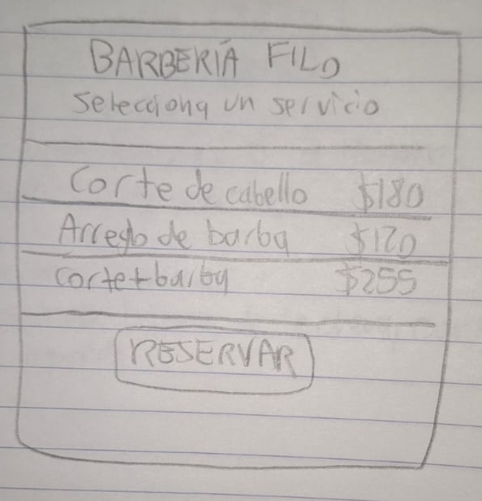

# 4. Refinamiento y escenarios

**Ejercicio 4 · Tema 7 · 🎩 Product Owner (PO) y 🎩 Desarrollador**

Los escenarios BDD correspondientes a las reglas R1 y R2 se encuentran en la carpeta `features/`.

## 4.1 Pesar (MoSCoW)

**Criterio que usé:**

Prioricé como Must las historias esenciales para calcular precios, aplicar descuentos, determinar penalizaciones y respetar las reglas de reservación de Barbería Filo.

Clasifiqué como Should las funcionalidades importantes que pueden esperar, como consultar la agenda y recibir confirmaciones. Como Could dejé funciones complementarias, mientras que las épicas pendientes de refinamiento se clasificaron como Won't para esta entrega.

La priorización se encuentra registrada en el campo `Prioridad` de [GitHub Projects — Barbería Filo](https://github.com/users/RobertoDanRam/projects/1/views/1).

## 4.2 Ilustrar

**Historia:** [H01 — Consultar servicios y precios (#1)](https://github.com/RobertoDanRam/apartalo-barberia/issues/1)

**Boceto:** [Ver imagen en GitHub](https://github.com/RobertoDanRam/apartalo-barberia/blob/main/docs/img/boceto_servicios.png)

El boceto muestra una pantalla donde el cliente puede consultar los precios de corte de cabello, arreglo de barba y servicio combinado, además de identificar fácilmente la opción para reservar una cita.

La propuesta busca atender la necesidad de Don Rogelio de ofrecer un proceso de reservación sencillo y visible.

## 4.3 Medir

**Escala de puntos:** 1, 2, 3, 5, 8, 13 y 21.

Se utilizó la escala indicada en el Tema 7 para estimar el esfuerzo relativo de cada historia, considerando su complejidad, la cantidad de reglas involucradas y la incertidumbre de implementación.

Los puntos fueron asignados en el campo `Puntos` de [GitHub Projects](https://github.com/users/RobertoDanRam/projects/1/views/1).

Las historias de cálculo de precios y descuentos tienen estimaciones pequeñas debido a que sus reglas de negocio están claramente definidas. En cambio, las historias de reservación y administración de citas requieren más trabajo y validaciones.

La historia H07 recibió inicialmente 13 puntos, por lo que fue seleccionada para dividirse durante el refinamiento.

Las épicas no reciben puntos definitivos porque todavía deben analizarse y descomponerse en historias pequeñas.

## 4.4 Dividir

- **Velocidades de referencia de mi variante:** 14, 18 y 16 puntos.
- **Operación:** (14 + 18 + 16) / 3 = 16 puntos de velocidad promedio.
- **Carga máxima por historia:** 16 / 2 = **8 puntos**.
- **Historia que rebasa la carga máxima:** H07 — Solicitar una cita, estimada inicialmente en 13 puntos.

| Historia original | Puntos | Subhistorias (issues) | Puntos de cada una | ¿Cómo la partí? |
|---|---:|---|---|---|
| [H07 — Solicitar una cita (#7)](https://github.com/RobertoDanRam/apartalo-barberia/issues/7) | 13 | [H07A — #17](https://github.com/RobertoDanRam/apartalo-barberia/issues/17) y [H07B — #18](https://github.com/RobertoDanRam/apartalo-barberia/issues/18) | 5 y 8 | Separé la selección del servicio, fecha y hora de la validación y registro de la reservación. Ambas subhistorias cumplen con la carga máxima permitida. |

La historia original debe permanecer cerrada con la explicación **dividida** y con enlaces a ambas subhistorias, conservando la trazabilidad del refinamiento.

Las subhistorias permanecen pendientes de desarrollo para un sprint posterior.

## 4.5 Escenarios BDD

Los escenarios de las reglas de negocio se documentaron en español, utilizando el formato Dado–Cuando–Entonces.

**Regla R1 — Total del servicio:**

Archivo: [features/01_total_servicio.feature](../features/01_total_servicio.feature)

Incluye ejemplos para corte individual, barba individual, ambos servicios combinados y descuentos por cliente frecuente. Se comprueba el límite de cinco visitas mensuales.

**Regla R2 — Cancelaciones:**

Archivo: [features/02_cancelacion.feature](../features/02_cancelacion.feature)

Incluye ejemplos con 24 horas, 2 horas y menos de 2 horas de anticipación, así como un escenario independiente de inasistencia.

Estos escenarios se transformaron en pruebas automatizadas utilizando `pytest.mark.parametrize` durante el Ejercicio 6.

## 4.6 R2 como tabla FIT

La siguiente tabla presenta los resultados esperados definidos antes de la implementación y los resultados reales comprobados mediante pytest.

| Situación (entrada) | Horas de anticipación (entrada) | Total de reserva (entrada) | Resultado esperado | Resultado real |
|---|---:|---:|---:|---|
| Cancelación | 48 | $200 | $0 | ✅ $0 |
| Cancelación | 24 | $200 | $0 | ✅ $0 |
| Cancelación | 23 | $200 | $100 | ✅ $100 |
| Cancelación | 2 | $200 | $100 | ✅ $100 |
| Cancelación | 1 | $200 | $200 | ✅ $200 |
| Cancelación | 0 | $200 | $200 | ✅ $200 |
| Inasistencia | No aplica | $200 | $200 | ✅ $200 |

**Interpretación:**

- Con 24 horas o más de anticipación, no se cobra penalización.
- Con 2 horas o más, pero menos de 24 horas, se cobra el 50 % del servicio reservado.
- Con menos de 2 horas o en caso de inasistencia, se cobra el 100 %.

**Resultados de las pruebas:**

Los siete casos de la tabla FIT fueron comprobados mediante las pruebas automatizadas de R2.

Se obtuvo el resultado esperado en cada caso: **7 de 7 casos aprobados (100 %)**.

La ejecución completa de pytest terminó con **34 pruebas aprobadas y 0 fallidas**.

**Evidencia:** [Resultados de pytest — Sprint 1](../evidencias/pytest_sprint1.txt)

Adicionalmente, se comprobó el límite de exactamente 24 horas mediante una prueba de regresión. Al provocar un cambio incorrecto en el operador de comparación, la prueba detectó un cobro indebido de $100; después de corregir el código, volvió a aprobarse.

La explicación y las evidencias de regresión están documentadas en [06_tdd.md](06_tdd.md).